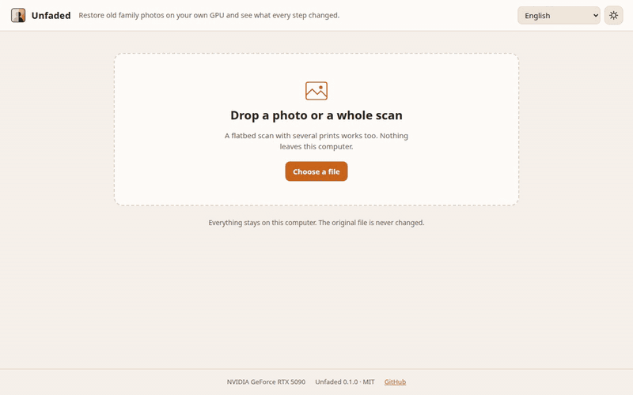
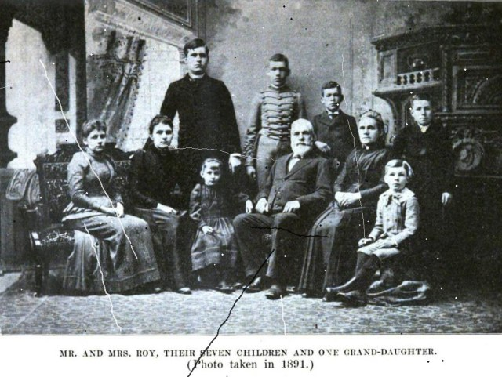
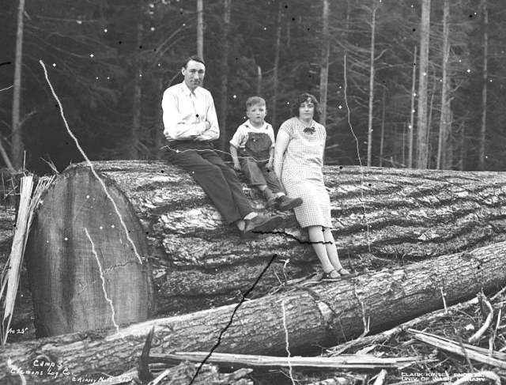
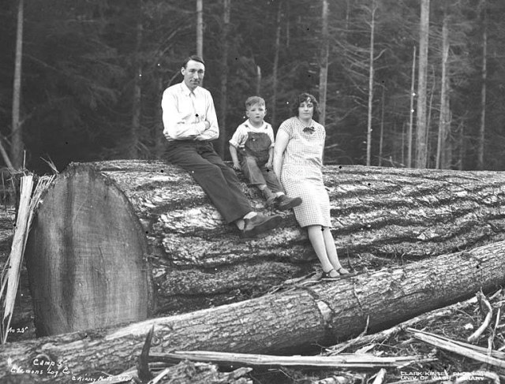

<div align="center">


# Unfaded

**Restore old family photos on your own GPU and see what every step changed.**

[English](README.md) | [Traditional Chinese](README.zh-TW.md) | [Simplified Chinese](README.zh-CN.md) | [Japanese](README.ja.md) | [Korean](README.ko.md) | [Spanish](README.es.md) | [French](README.fr.md) | [German](README.de.md) | [Brazilian Portuguese](README.pt-BR.md)

[](https://github.com/Arthur031221/Unfaded/actions/workflows/ci.yml)
[](LICENSE)
[](docs/install.md)

</div>

On four public domain photos with scratches I drew on at fixed seeds, the repair step raised mean PSNR from 26.8 dB to 31.0 dB, and the splitter found 12 of 12 prints on synthetic scans with a mean overlap (IoU) of 0.95. PSNR improved on all four photos. `unfaded bench` reproduces it, and the method is under [Benchmark](#benchmark).



There's a [live demo](https://arthur031221.github.io/Unfaded/) with real output on three example scans. It can't process your own files. Install the tool for that.

## Before and after

| | Before | After |
| --- | --- | --- |
| Creased family portrait, 1891 |  |  |
| Logging camp, 1926 |  |  |

Both are public domain scans with synthetic scratches, a crease and dust added by `scripts/make_demo.py`. After is the default pipeline: split, tone, repair, faces at 35 percent. The detector also runs on the inverted image, which is how it finds the dark scratches, but it still misses some thin dark lines, see [Limits](#limits).

Models make things up, so the tool says so. Every step that drew pixels is labelled "invented by the model", the Invented view paints exactly where, and the original file is never touched.

## What it does

Unfaded is a short pipeline. You can switch off any step, and each one reports how much of the print it changed.

| Step | What happens | Model | Default |
| --- | --- | --- | --- |
| Split | Cuts each print out of a flatbed scan and straightens it. Corners can be dragged by hand. | OpenCV, no model | on |
| Fade | Restores levels, removes the colour cast. Skipped when the print already spans 80 percent of the tonal range. | none | on |
| Repair | Finds scratches, creases and dust, then fills them. Skipped if more than 15 percent of the print would be filled. You can paint the mask yourself. | Old photo scratch detector, LaMa | on |
| Faces | Restores each face with its own strength slider. 0 keeps the old face, 100 uses what GFPGAN draws. | YuNet, GFPGAN v1.4 | on, 35 |
| Colour | Predicts colour for black and white prints. Lightness is never changed. | DDColor | off |
| Enlarge | 2x or 4x with tiling for large prints. | Real-ESRGAN x4plus | off |

Each result gets an `.xmp` sidecar with the source file's sha256, every step with its model and settings, and the steps where a model generated pixels.

## Install

Python 3.10 or newer. Model weights, about 1.3 GB in total, are downloaded on first use and checked against a pinned sha256. After that nothing leaves your machine.

<details>
<summary>Linux with an NVIDIA GPU (tested)</summary>

```bash
git clone https://github.com/Arthur031221/Unfaded
cd Unfaded
python -m venv .venv && source .venv/bin/activate
pip install torch --index-url https://download.pytorch.org/whl/cu128
pip install -e .
unfaded models --fetch
```

I developed it on an RTX 5090 with torch 2.11 and CUDA 12.8.

</details>

<details>
<summary>Any machine without a GPU</summary>

```bash
pip install torch --index-url https://download.pytorch.org/whl/cpu
pip install -e .
unfaded restore scan.jpg --device cpu
```

It works but is slow, see the timings below.

</details>

<details>
<summary>macOS and Windows (not tested)</summary>

The code has no platform specific parts, so `pip install -e .` should work. I haven't run it on either system. On a Mac you can try `--device mps`. `auto` only picks CUDA or the CPU.

</details>

More in [docs/install.md](docs/install.md).

## Use it

```bash
unfaded restore examples/scans/album-damaged.jpg -o restored --explain
```

That's the command I ran for the demo. It found four prints in the scan and wrote `album-damaged.unfaded-1.jpg` to `-4.jpg` with a sidecar each. On the RTX 5090 it took 12 seconds including model loading. `--explain` shows what each step did:

```
album-damaged.jpg: 4 prints
  wrote restored/album-damaged.unfaded-1.jpg
    fade              skipped   0.01s  the print already uses 92% of the tonal range
    repair       4.0% changed   5.93s
    faces        1.2% changed   1.15s
```

More options:

```bash
unfaded restore album/ -o restored/            # a whole folder
unfaded restore scan.jpg --colorize --scale 2  # add colour and enlarge
unfaded restore scan.jpg --face-strength 60    # stronger faces
unfaded split scan.jpg                         # only cut out the prints
unfaded serve                                  # local web interface on 127.0.0.1:8765
```

The web interface shows the outlines it found and lets you fix them. Then it runs the pipeline and lets you step through the result with a before and after slider, a heat map of what changed, an Invented view, a mask editor and a strength slider per face. It has light and dark themes, works on a phone and comes in English, Traditional Chinese, Simplified Chinese, Japanese, Korean, Spanish, French, German and Brazilian Portuguese. Full reference: [docs/usage.md](docs/usage.md), [docs/configuration.md](docs/configuration.md).

## Benchmark

`unfaded bench` runs everything below, with seed 5. The raw output of my run is in [docs/benchmark.json](docs/benchmark.json).

**Repair.** The four photos in `examples/photos` are treated as the clean reference. Each is fitted to 1600 pixels, scratches, creases and dust are drawn on with a known mask, and only the repair step runs. PSNR is measured against the clean image.

| Photo | PSNR damaged | PSNR repaired | SSIM damaged | SSIM repaired |
| --- | --- | --- | --- | --- |
| Logging camp | 24.90 | 25.65 | 0.954 | 0.943 |
| King family | 28.22 | 38.88 | 0.971 | 0.988 |
| Knowles family | 26.96 | 27.98 | 0.975 | 0.965 |
| Roy family | 27.01 | 31.68 | 0.969 | 0.982 |
| Mean | 26.77 | 31.05 | 0.967 | 0.970 |

PSNR improved on all four photos and SSIM on two. On the camp and Knowles photos the detector marked parts of the texture as damage and the fill lowered SSIM slightly. The mean gain in SSIM is only 0.003. Dark scratches are found by running the detector on the inverted image with its scores halved. I picked that weight on this same seed. On seeds 11 and 23 the mean PSNR gain over the earlier single pass detector was 0.9 dB and 0.2 dB. Everything is measured on damage I drew myself, which is easier than real wear, so treat it as a regression check, not a promise about your photos.

**Split.** The example prints are placed four to a scan on three backgrounds at random angles. All 12 prints were found, mean IoU 0.952, worst 0.931.

**Speed.** One run per device after a warm up, with every step on except split, tone recovery forced and 2x enlarge.

| Device | Image size | fade | repair | faces | colour | enlarge | total |
| --- | --- | --- | --- | --- | --- | --- | --- |
| RTX 5090 | 960 x 1200 | 0.07 s | 0.40 s | 0.22 s | 0.06 s | 1.51 s | 2.26 s |
| Ryzen 5 7500F, CPU | 480 x 600 | 0.02 s | 9.26 s | 12.32 s | 1.87 s | 81.80 s | 105.27 s |

The CPU row uses a smaller image because the full size takes too long, so the two rows aren't comparable by size. Without enlarge, which is off by default, the CPU run takes about 22 seconds.

## Limits

- The scratch detector is trained mostly on light scratches. Dark scratches are found by running it on the inverted image at half weight, so thin dark lines are still missed more often than light ones. Paint them in the mask editor.
- On textured or dirty areas the detector gives false positives, which is how the camp and Knowles photos lost SSIM. The 15 percent guard stops only the worst cases.
- GFPGAN draws faces. At strength 100 a face can look like a different person. The default is 35 for that reason, and the Invented view shows where it acted.
- DDColor guesses colour and tends to a warm cast. Treat colourised output as an illustration.
- Tone recovery turns sepia prints neutral grey.
- The splitter is classical image processing. White bordered prints on a white scanner lid can be cut wrong. Fix the outline by dragging the corners.
- The live demo is a replay of precomputed output. Only the face and colour sliders react.

## How it compares

Bringing Old Photos Back to Life, GFPGAN, LaMa and Real-ESRGAN are the models doing the work here, and each is a separate research repository with its own command line. Unfaded doesn't improve on any of them. What it adds is the assembly: one command for a whole scan, a skip rule for steps that would hurt, a per step change view, and a record of what the models invented.

## Project layout

```
src/unfaded/        pipeline, one module per step, server, benchmark
src/unfaded/web/    interface and 9 locale files
demo/               precomputed output for the GitHub Pages demo
examples/           public domain photos and damaged scans, with sources
docs/               install, usage, configuration, architecture
tests/              unit tests, browser test, end to end tests that need the weights
```

Design notes are in [docs/architecture.md](docs/architecture.md), contribution rules in [CONTRIBUTING.md](CONTRIBUTING.md) and model licenses in [THIRD_PARTY_NOTICES.md](THIRD_PARTY_NOTICES.md).

## License

MIT. The model weights keep their own licenses, listed in the notices file.

Assisted by Claude/Codex.
